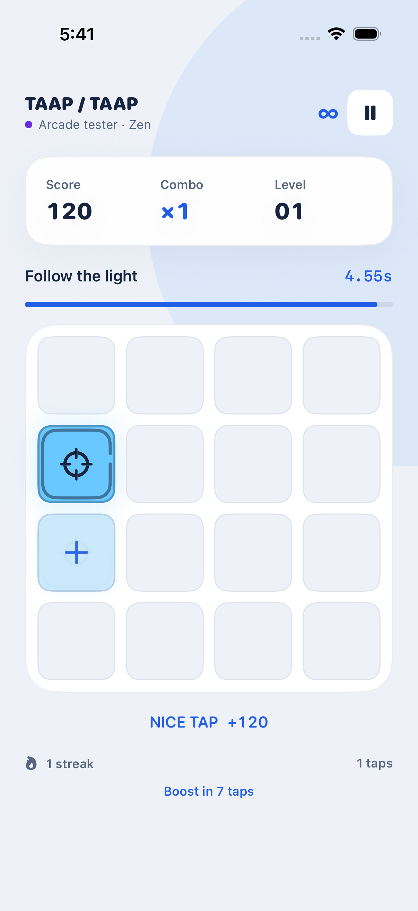
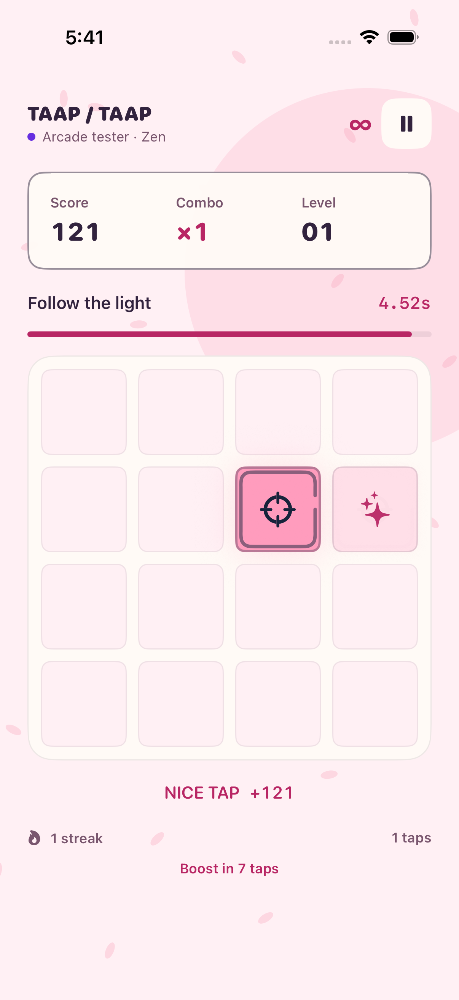
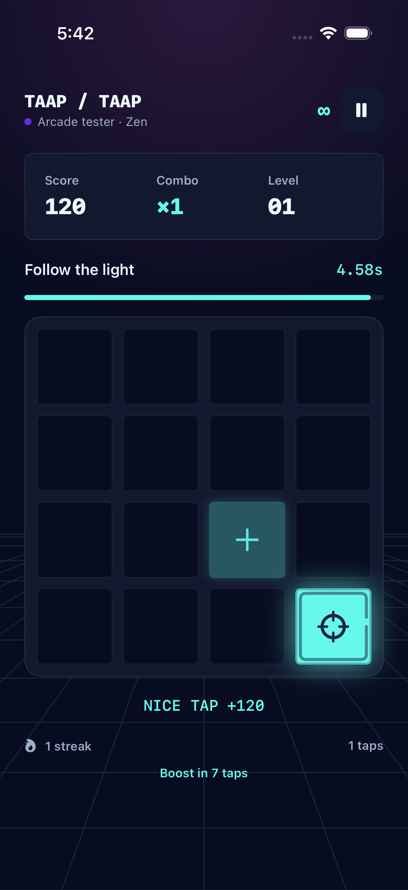

# Taap Taap

A reaction arcade for **iPhone, iPad, and native macOS**. Chase the bright square, build a combo, and catch power-ups as the board gets faster.

<p>
  
  
  
</p>

Theme previews from the previous 4×4 layout; the current game uses 24 squares. [Design notes and skill references](docs/DESIGN.md).

## Play your way

- **Classic:** three starting lives; survive as long as you can.
- **Rush:** a 60-second score attack. Misses break your combo, but do not end the run.
- **Zen:** untimed practice without losing lives. Pause and choose “Finish practice & save” to record a session.

The board has **four columns and six rows (24 squares)** in every mode. Short landscape windows arrange the same 24 squares as six columns by four rows so the board stays visible.

Every target starts with a **five-second** window. Each hit or expired target multiplies the next window by **0.95**, down to **0.45 seconds** (one second in Zen). Correct taps move the light immediately; letting the timer expire moves it automatically and applies a penalty. The target always moves to a different square.

Earn **100 points + up to 50 reaction points**, multiplied by your current combo. Every five consecutive hits adds a multiplier, capped at **8×**. A miss resets the combo while keeping points already earned.

After every eight successful hits, the next target carries an equally likely collectible from the mode's available pool:

| Item | Effect |
| --- | --- |
| Extra life | Adds a heart, up to five. Classic only. |
| Slow motion | Targets count down at half speed for five real seconds. The Rush clock keeps running. Collecting again refreshes the effect. |
| Shield | Protects lives and combo from one mistake or timeout. Does not stack. |

Collectibles expire with their target. Sessions pause when the app becomes inactive; resume explicitly when ready. Leaving an unfinished run discards its score. Replays count as new games.

## Three visual themes

Choose a theme on the home screen; your selection is saved on the device.

- **Studio (default):** blue and white, soft depth, rounded tiles, minimal ornament.
- **Sakura:** original anime/Japanese-inspired art direction, pink petals, an ink palette, manga sunburst, and outlined panels.
- **Cyber:** cyan/magenta neon, angular tiles, skyline graphics, and a retro perspective grid.

The themes cover the home screen, board, controls, player creation, pause, leaderboard, and results. Artwork is drawn in SwiftUI, so it stays sharp on Retina displays without downloads. Targets have a distinct symbol, border, and timer; color is not the only cue. Hit effects respect Reduce Motion. iOS includes tap haptics.

Local profiles and older leaderboard data are preserved. Leaderboards are filtered by mode; old scores appear under Classic with a Legacy label because the scoring rules changed. Data is stored locally, without accounts or cloud sync.

## Build and run

Requires **Xcode 16+**, Swift 6, and [XcodeGen](https://github.com/yonaskolb/XcodeGen). Deployment targets: iOS/iPadOS 17 and macOS 14.

```sh
brew install xcodegen
./scripts/setup_xcode.sh
```

Choose the **TaapTaap** scheme for iPhone/iPad, or **TaapTaapMac** for native macOS. For physical devices, select your signing team in Xcode. The project is generated from `project.yml`; do not edit or commit the generated `.xcodeproj`.

```sh
make test       # Core tests (also supported on Linux with Swift 6)
make build-ios  # Unsigned iPhone/iPad simulator build
make build-mac  # Unsigned native macOS build
```

Touch or click the bright tile. Hardware keyboard controls map each board row to **1234 / QWER / ASDF / ZXCV / 5678 / TYUI**; **Space** pauses/resumes. The board adapts to portrait, landscape, iPad split views, and resizable Mac windows. Large layouts show a side panel with the power-up guide.

## Validation

GitHub Actions runs core tests, builds both Apple apps, and exercises all themes, gameplay, pause/resume, and landscape on iPhone and iPad simulators. Screenshots and test result bundles are uploaded as the `apple-ui-results-iPhone` and `apple-ui-results-iPad` artifacts.

The core tests cover score accumulation, combo caps, acceleration, expired taps, timer catch-up, all power-ups, pause/resume, mode end conditions, restart, and legacy persistence. Before release, review simulator screenshots and run the [device checklist](docs/DESIGN.md) on real hardware, particularly Dynamic Type, VoiceOver, haptics, and reaction timing. Signing, App Store packaging, and distribution remain separate release steps.

## Structure

- `Sources/TaapTaapCore`: platform-independent rules, models, persistence.
- `TaapTaapiOS`: shared SwiftUI app, themes, and view models for all Apple targets.
- `Tests/TaapTaapCoreTests`: deterministic Swift Testing coverage.
- `Tests/TaapTaapUITests`: simulator interaction checks and screenshots.
- `docs/DESIGN.md`: art direction, balancing rationale, skill references, and playtest checklist.
